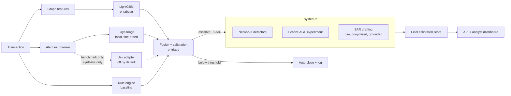

# AML Sentinel

AML Sentinel is a real-time anti-money-laundering transaction monitoring system. It
uses a fast System 1 triage stage and a slow System 2 investigation stage, and
drafts SARs for human review.

> **Status:** Phase 1 (scaffold and data) is complete. Results, the dashboard and
> full documentation arrive in later phases.
>
> **Synthetic data only.** Results on IBM AMLworld do not prove real-world
> performance.

## Problem

Over 90% of AML alerts at banks are false positives. AML Sentinel aims to:

1. detect laundering patterns on a transaction graph,
2. rank alerts by calibrated risk, to beat a rule-based baseline on false positives,
3. draft grounded SAR narratives for analyst review,
4. give analysts a case-management dashboard.

## Architecture



## Quickstart

```bash
make setup     # venv + hash-verified install + pre-commit hooks
# put the IBM files in data/raw/ (see data/README.md)
make data      # validate + build parquet caches
make check     # ruff, mypy --strict, pytest, bandit, pip-audit
```

On Windows without GNU make, run the commands listed under each target in the
`Makefile`.

## Data

See [data/README.md](data/README.md) for the source, license check, schema,
checksums and known quirks.

## Results

Results will be filled in from real measurements in Phases 2–8.

## Limitations

The full list is written in Phase 8. For now, note these:

- Synthetic data only.
- Typology labels cover only part of the positives.

## Docs

- [SECURITY.md](SECURITY.md)
- [docs/DECISIONS.md](docs/DECISIONS.md)
