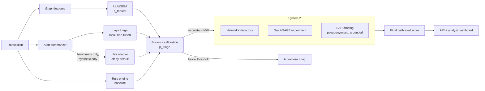

# AML Sentinel

**An anti-money-laundering alert-triage system: it ranks alerts by calibrated risk,
explains each score feature by feature, adds graph evidence and drafts grounded SARs
for analyst review. On synthetic IBM AMLworld data it cut false positives in the top 5%
of the alert queue from 170 to 49, and matched the rule baseline's recall with 99% fewer
false positives. Every number is measured, including where it did not work.**

[](https://github.com/1005Manasvi/AML_Sentinel/actions/workflows/ci.yml)

[](LICENSE)


<!-- Screenshot: replace with docs/assets/dashboard.png (see docs/assets/README.md). -->

> **Synthetic data only.** Every result comes from IBM AMLworld or this project's own
> generator. Nothing has been validated on real transactions.
>
> **How it was built.** Built by Manasvi Patil with an AI pair-programmer (Claude Code).
> Design decisions and their reasons are recorded in [docs/DECISIONS.md](docs/DECISIONS.md),
> and every result is reproducible from the commands in [docs/RESULTS.md](docs/RESULTS.md)
> and checked against its report by tests.

## Key results

Measured on the HI-Small test split (2022-09-09 to 09-10, 862,792 transactions, 0.11%
laundering), seed 42. Details, figures and caveats: [docs/RESULTS.md](docs/RESULTS.md).

| Measure (HI-Small test) | Rule baseline | AML Sentinel |
|---|---:|---:|
| PR-AUC, every test transaction | 0.0016 | 0.4162 (LightGBM) |
| False positives at the rules' recall (52.1%) | 267,772 | 2,332 (−99.1%) |
| False positives in the top 5% of the 4,000-alert queue | 170 | 49 (+ LightGBM) |
| PR-AUC inside the alert queue (6.8% base rate) | 0.116 | 0.675 (+ Laya) |
| Laya alone inside the queue, PR-AUC | | 0.096 (near random) |
| Latency per transaction, rules vs LightGBM | 2.9 µs | 8.4 µs |

**Read these honestly:**

- **The rule baseline is weak.** It flags 31% of transactions at 0.19% precision, so
  almost any model beats it by a wide margin. PR-AUC and precision@k are the fairer
  view (ADR-009).
- **LightGBM over past-only graph features does almost all the work.** The fine-tuned
  Laya decision model is near random on its own and adds only +0.010 PR-AUC in fusion.
  System 2 graph evidence adds no significant ranking gain; its value is the evidence
  it puts in each case and SAR.

## Quickstart

```bash
git clone https://github.com/1005Manasvi/AML_Sentinel.git && cd AML_Sentinel
make setup   # venv + hash-verified dependencies + pre-commit hooks
make demo    # rebuild the bundled sample's models, start API + dashboard (ready in ~15 s here)
```

Open <http://localhost:8501> and sign in with one of the two keys `make demo` prints
(analyst or admin). They are minted for that run only. No Kaggle data, GPU or API key
is needed.

**Or with Docker:** `docker compose up --build`, then read the keys with
`docker compose logs demo`.

**Windows:** use GNU Make from Git Bash. MinGW builds name it `mingw32-make`
(`mingw32-make setup`, `mingw32-make demo`). Clone to a short path such as
`C:\src\aml-sentinel`: a dev dependency (debugpy) has deep file paths that can exceed
Windows' 260-character limit unless long paths are enabled. Without make, run the
commands listed under each Makefile target.

The demo runs rules, LightGBM, calibration, per-alert TreeSHAP explanations, the
System 2 detectors and the local SAR template. It does not run Laya (2.4 GB checkpoint plus torch) or the GNN. Their
results come from the full pipeline, and the sample is a workflow demo, not evidence
of model quality (ADR-015).

### Full pipeline on IBM AMLworld

```bash
# put the IBM files in data/raw/ (see data/README.md)
make data baseline train        # rules + LightGBM (CPU)
make laya-setup gnn-setup       # optional stacks: Laya (torch) and PyTorch Geometric
make reproduce                  # every table and figure in docs/RESULTS.md (GPU, ~3 h)
make check                      # ruff, mypy --strict, pytest, bandit, pip-audit
```

## How it works

System 1 is a fast, cheap layer that screens every transaction. System 2 runs slow,
deep analysis only on the alerts System 1 escalates.



| Stage | What it does | Why |
|---|---|---|
| Rule engine | Amount threshold, high-risk jurisdiction (synthetic list), velocity | The baseline every model is reported against |
| LightGBM | Past-only graph features: degree, flow ratios, velocity, short cycles, counterparty diversity | Fast, strong; each alert's score is explained feature by feature with exact TreeSHAP |
| Laya | Local, fine-tuned decision model answering typology / risk / escalate questions over a text summary | Tests whether a small text model adds signal; measured honestly (ADR-014) |
| Jev | Hosted decision-model adapter, **benchmark-only, synthetic-only, off by default** | A closed API must never see customer data; enforced in code (ADR-013) |
| Fusion + calibration | Logistic stacker, then isotonic or Platt chosen on validation | Interpretable weights; scores are never shown as raw probabilities |
| System 2 detectors | Circular flows, structuring, fan-in/out, scatter-gather on past-only case subgraphs | Named, checkable evidence for the analyst and the SAR |
| GraphSAGE | Experiment, compared with LightGBM on the same inputs | Honest test of whether message passing helps here (it did not) |
| Drift monitoring | PSI of every feature and of the score between train, validation and test | Shows what moved between periods, and what did not (ADR-025) |
| SAR drafting | Local template by default; optional LLM gets pseudonymised facts only; every figure grounded | Drafts are stamped *DRAFT - requires analyst review* and audited |
| API + dashboard | FastAPI with API keys, roles, rate limits, strict CORS; Streamlit queue, graph, SAR editor, audit view | Analysts decide; every action is audited in a hash-chained log |

More: [docs/ARCHITECTURE.md](docs/ARCHITECTURE.md) and the 25 short ADRs in
[docs/DECISIONS.md](docs/DECISIONS.md).

## Security

Treat every transaction field as untrusted. In short:

- No secrets in code or logs; settings fail fast when a key a feature needs is missing.
- API keys are stored as SHA-256 digests and compared in constant time; analyst and
  admin roles; rate limits, request size limits, secure headers.
- Models load only from local paths after checksum verification; safetensors and
  native formats are used, never pickle.
- Prompt injection: the alert summarizer emits only computed numeric facts, never
  free text; the SAR drafter delimits data, rejects off-schema replies, pseudonymises
  before any external call and grounds every account, amount and date.
- Hash-locked dependencies; ruff, mypy --strict, bandit, pip-audit and gitleaks in CI
  and pre-commit; the Docker image runs as non-root with hash-verified wheels.

Threat model, trust boundaries and known limitations: [SECURITY.md](SECURITY.md).

## Data

The IBM AMLworld data (Altman et al., NeurIPS 2023) comes from Kaggle and is never
committed. See [data/README.md](data/README.md) for files, schema, licence check and
checksums. The bundled `data/sample/` is generated by this project (seed 42), so the
demo needs no download.

## Limitations

**Data and validity**

- **Synthetic data only.** Every number comes from IBM AMLworld or the project's own
  generator. Nothing here has been validated on real transactions, and simulator
  artifacts help the models: payment format and cross-currency flags are shortcuts
  (ADR-010).
- **Labels are incomplete and partly undocumented.** About 39% of HI-Small test
  positives belong to no documented pattern, and the model finds them far less
  often than documented ones (see the evaluation's attempt-overlap section).
- **Attempts cross split boundaries.** Some test positives continue laundering
  attempts that started in training, so part of the test performance is recognising
  known actors (ADR-003).
- **Short test window:** two days, with about 950 HI-Small positives and 271 in the
  alert sample. The bootstrap intervals resample rows, not attempts, so they are
  optimistic.

**Modelling**

- **Calibration does not transfer cleanly over time.** Validation-fitted calibrators
  made test ECE worse on the full split (ADR-011). The highest-scored alerts can
  display 1.000 (ADR-022), so the API shows each score's measured test reliability
  next to it.
- **Laya adds little.** It is close to random alone and adds +0.01 to +0.03 PR-AUC in
  fusion, at about 300 ms of GPU time per alert. The full fine-tune is unmeasured.
- **System 2 evidence explains alerts but does not reliably improve ranking.** The
  GNN gain in the ablation relies on lookahead and is not deployable in real time.
- **No adversarial evaluation.** Fixed thresholds (for example, structuring at
  80–100% of 10k USD) can be learned and avoided.

**Fairness and de-risking**

- The data has no customer attributes, so fairness across protected groups **cannot
  be measured** here. In real deployments, monitoring systems tend to concentrate
  alerts on certain customer segments, corridors and cash-intensive businesses. That
  can lead to unfair account closures ("de-risking") and exclusion from financial
  services.
- The synthetic "high-risk jurisdiction" rule (ADR-008) shows how geography-based
  rules flag people by where they bank. Any real list would need legal and fairness
  review.
- Scores are prioritisation aids. Every decision stays with a human analyst, and
  every SAR draft is stamped for review.

**What production would additionally require**

- Model risk management: independent validation, documented assumptions, change
  control and ongoing performance and drift monitoring (for example SR 11-7 style).
- Regulatory validation of the scenarios and thresholds, and evidence of coverage
  for the institution's own risk assessment.
- Streaming infrastructure and an online feature store (the API's `/score` rebuilds
  features from history and is capped at 100k rows).
- Per-jurisdiction SAR formats and filing workflows (FinCEN, goAML and others), with
  a four-eyes approval rule.
- Identity integration (OIDC), TLS, signed model artifacts, WORM anchoring of the
  audit log, and data-protection reviews for any external LLM use.

## Docs

- [docs/RESULTS.md](docs/RESULTS.md): every measured result, figures, how to reproduce, what did not work
- [docs/ARCHITECTURE.md](docs/ARCHITECTURE.md): components, data flow, artifacts, runtime
- [docs/DECISIONS.md](docs/DECISIONS.md): ADR-001 to ADR-025
- [docs/MODEL_CARD.md](docs/MODEL_CARD.md): intended use, metrics, calibration, failure modes, fairness
- [SECURITY.md](SECURITY.md): threat model
- [docs/BLOG_POST.md](docs/BLOG_POST.md): engineering write-up
- [docs/INTERVIEW_PREP.md](docs/INTERVIEW_PREP.md): likely interview questions, answered from this repo
- [CONTRIBUTING.md](CONTRIBUTING.md) · [CHANGELOG.md](CHANGELOG.md) · [LICENSE](LICENSE) (MIT)
