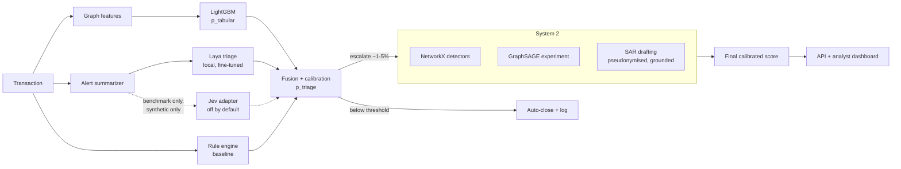
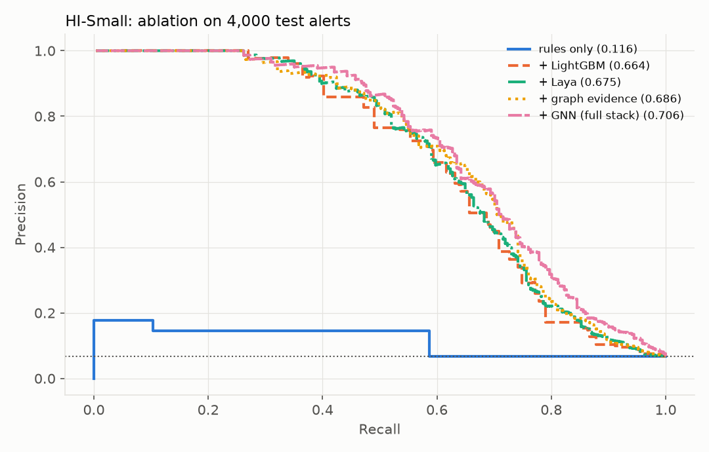

# AML Sentinel

AML Sentinel is a real-time anti-money-laundering transaction monitoring system. It
uses a fast System 1 triage stage and a slow System 2 investigation stage, and
drafts SARs for human review.

> **Status:** Phases 1–8 are complete: data, baselines, System 1 and 2, final
> ranking, SAR drafting, the authenticated API, the analyst dashboard, and the
> evaluation and hardening pass. The one-command demo and portfolio packaging
> (Phase 9) follow.
>
> **Synthetic data only.** Results on IBM AMLworld do not prove real-world
> performance.

## Problem

Over 90% of AML alerts at banks are false positives. AML Sentinel aims to:

1. detect laundering patterns on a transaction graph,
2. rank alerts by calibrated risk, to beat a rule-based baseline on false positives,
3. draft grounded SAR narratives for analyst review,
4. give analysts a case-management dashboard.

## Architecture



## Quickstart

```bash
make setup     # venv + hash-verified install + pre-commit hooks
# put the IBM files in data/raw/ (see data/README.md)
make data      # validate + build parquet caches
make check     # ruff, mypy --strict, pytest, bandit, pip-audit
```

On Windows without GNU make, run the commands listed under each target in the
`Makefile`.

### Run the API and dashboard (bundled sample, no Kaggle data needed)

```bash
make sample-models                      # synthetic sample + rule baseline + LightGBM (about 1 min)
make api-key KEY_USER=alice KEY_ROLE=admin     # prints the key once + its API_KEYS entry
# put the API_KEYS entry in .env (only the digest is stored), then:
make run                                # API on 127.0.0.1:8000, dashboard on 127.0.0.1:8501
```

Sign in to the dashboard with the printed key. `API_DATASET=HI-Small` serves the
IBM results once they have been produced (`make rank`).

## Data

See [data/README.md](data/README.md) for the source, license check, schema,
checksums and known quirks.

## Results

### Rule baseline (Phase 2)

These numbers are measured on IBM AMLworld. The test split covers 2022-09-09
to 09-10, and alerts are counted per transaction. The baseline to beat is
chosen on validation F1 (ADR-009). The jurisdiction rule uses a **synthetic**
bank list (ADR-008).

| Dataset | Baseline | Test base rate | Precision | Recall | FPR | Alerts/day |
|---|---|---:|---:|---:|---:|---:|
| HI-Small | static (10k USD, ≥24 payments/day, synthetic banks) | 0.111% | 0.19% | 52.1% | 31.1% | 134,135 |
| LI-Small | tuned (≥50 payments/day only) | 0.057% | 0.14% | 22.3% | 9.2% | 54,199 |

To regenerate: `make data && make baseline`. Full reports are in
[reports/baseline/](reports/baseline/).

**How to read this:**

- The rules are only 1.7 times (HI) and 2.4 times (LI) better than random,
  measured as precision over the base rate.
- They create an unworkable alert volume: about 9–31% of all transactions.
- This is typical of threshold rules at this level of class imbalance. It also
  means the bar is low, so later phases compare models at **matched alert
  volumes** rather than claiming a big win against this baseline.

### System 1a: LightGBM over graph features (Phase 3)

These are measured on the same test split. **FP reduction at matched recall** means
the model raises the fewest alerts that catch as many laundering transactions as
the rule baseline, and the table counts how many fewer false positives that
produces. Both feature variants are shown (ADR-010).

| Dataset | Model | PR-AUC | Precision@1,000 | Alerts at baseline recall (model vs rules) | FP reduction at matched recall | Test ECE raw → calibrated |
|---|---|---:|---:|---:|---:|---:|
| HI-Small | rules (static) | 0.0016 | n/a | n/a | n/a | n/a |
| HI-Small | LightGBM [all] | 0.4162 | 40.9% | 2,830 vs 268,270 | 99.1% | 0.00027 → 0.00036 |
| HI-Small | LightGBM [no_shortcuts] | 0.3716 | 37.3% | 5,054 vs 268,270 | 98.3% | 0.00026 → 0.00051 |
| LI-Small | rules (tuned) | 0.0007 | n/a | n/a | n/a | n/a |
| LI-Small | LightGBM [all] | 0.1011 | 9.9% | 4,012 vs 108,398 | 96.4% | 0.00012 → 0.00032 |
| LI-Small | LightGBM [no_shortcuts] | 0.0804 | 7.9% | 4,289 vs 108,398 | 96.2% | 0.00013 → 0.00041 |

To regenerate: `make train`. Reports and figures are in [reports/system1a/](reports/system1a/).

**How to read this (caveats):**

- **The large FP reductions come mostly from the weak baseline.** The rules flag
  9–31% of all transactions at 0.14–0.19% precision, so almost any ranking model
  beats them by a wide margin. Precision@k and PR-AUC are the fairer view of the
  model itself.
- **Removing the shortcut features does not remove the shortcut.** The
  `no_shortcuts` model never sees payment format, yet 100% of its top-100 HI-Small
  alerts are ACH. It recovers ACH-ness from correlated amount and flow features.
- **Calibration fitted on validation made test calibration worse** on both datasets
  (see the ECE column). On validation, held-out ECE improves 3–6×, but the
  score-to-label relationship drifts between the two periods (ADR-011). This is
  reported as is, not tuned away on test.
- These are results on synthetic data and do not show real-world performance.

### System 1b: Laya triage and fusion (Phase 4)

These are measured on HI-Small. Every model scores the **same 4,000 test alerts**,
sampled from the System 1a queue (the top 1% by LightGBM). The sample holds
271 laundering transactions, a 6.8% base rate
**within the queue**, so these numbers are not comparable with the full-split results
above. Laya is run zero-shot and with **head-only** fine-tuning (encoder frozen,
4 GB GPU). The full fine-tune runs on Kaggle (`scripts/kaggle_laya_full_finetune.py`)
and is not yet measured. Jev was not run (disabled, no key).

| Model | PR-AUC | ROC-AUC | Precision@100 | ECE | Typology accuracy / macro-F1 | ms per alert |
|---|---:|---:|---:|---:|---:|---:|
| lgbm_all | 0.649 | 0.879 | 95.0% | 0.023 | n/a / n/a | n/a |
| lgbm_no_shortcuts | 0.591 | 0.846 | 94.0% | 0.014 | n/a / n/a | n/a |
| laya[zero_shot] | 0.091 | 0.614 | 7.0% | 0.458 | 94.2% / 0.24 | 449 |
| laya[head_only] | 0.096 | 0.535 | 15.0% | 0.409 | 66.1% / 0.21 | 304 |
| fused[lgbm_all+laya[head_only]] | 0.674 | 0.881 | 96.0% | 0.021 | n/a | n/a |
| fused[lgbm_no_shortcuts+laya[head_only]] | 0.613 | 0.857 | 91.0% | 0.012 | n/a | n/a |

Does adding Laya to fusion help? This is a paired bootstrap over the test alerts. It
resamples rows only, so the intervals are optimistic.

| Fused model vs. the same fusion without Laya | PR-AUC gain | 95% CI |
|---|---:|---|
| fused[lgbm_all+laya[zero_shot]] vs fused[lgbm_all] | +0.025 | [+0.015, +0.036] |
| fused[lgbm_all+laya[head_only]] vs fused[lgbm_all] | +0.029 | [+0.021, +0.037] |
| fused[lgbm_no_shortcuts+laya[zero_shot]] vs fused[lgbm_no_shortcuts] | +0.002 | [-0.011, +0.015] |
| fused[lgbm_no_shortcuts+laya[head_only]] vs fused[lgbm_no_shortcuts] | +0.022 | [+0.010, +0.035] |

To regenerate: `make laya-data finetune-laya triage-text` (GPU; about 2.5 h on an
RTX 3050 Laptop). Full report: [reports/system1b/](reports/system1b/).

**What did not work (honest reading):**

- **Laya alone is close to random inside the alert queue.** Its PR-AUC is
  0.09–0.10 against LightGBM's 0.65, at a 6.8% base rate. Its ROC-AUC is 0.61
  zero-shot and 0.54 head-only, against LightGBM's 0.88. Laya's own README
  warns that the base model is "near chance" zero-shot, and a frozen encoder is not
  enough to fix that.
- **Head-only fine-tuning did not measurably improve Laya alone.** The PR-AUC gain is
  +0.005, with a 95% CI that includes 0. Its mean risk score is the same for
  laundering and benign alerts (3.55 vs 3.54), so the head learned the prior, not the
  signal.
- **Zero-shot "94% typology accuracy" is a majority-class artifact.** It labels every
  alert benign (macro-F1 0.24). Head-only labels many benign alerts as layering
  (macro-F1 0.21). There are no structuring cases in IBM test data (ADR-012).
- **Laya's raw probabilities are badly calibrated** (ECE of about 0.41–0.46). Its
  README says it is over-confident as shipped.
- **The only gain is in fusion, and it is small:** +0.02 to +0.03 PR-AUC when Laya's
  outputs are stacked with LightGBM. That costs about 300–450 ms of GPU time per
  alert. With the no-shortcut model, zero-shot Laya adds nothing significant.

### System 2: graph detectors and GNN experiment (Phase 5)

**NetworkX detectors.** These run on past-only case subgraphs: 2 hops, 72 h before
the alert, with hub accounts capped. They cover the same 4,000 HI-Small test
alerts as Phase 4 (271 laundering, a 6.8% base rate).
Every detector has a planted-pattern unit test.

| Detector | Fires | On laundering | On benign | Precision | Lift |
|---|---:|---:|---:|---:|---:|
| any | 1,156 | 51.7% | 27.2% | 12.1% | 1.79x |
| circular | 121 | 7.7% | 2.7% | 17.4% | 2.56x |
| structuring | 4 | 0.7% | 0.1% | 50.0% | 7.38x |
| fan_in | 691 | 22.5% | 16.9% | 8.8% | 1.30x |
| fan_out | 363 | 26.9% | 7.8% | 20.1% | 2.97x |
| scatter_gather | 37 | 9.6% | 0.3% | 70.3% | 10.37x |
| gather_scatter | 178 | 17.0% | 3.5% | 25.8% | 3.81x |

- The matching detector fired for these documented typologies: CYCLE 25.0%, FAN-IN 42.9%, FAN-OUT 70.6%, GATHER-SCATTER 28.8%, SCATTER-GATHER 52.5%.
  STACK, BIPARTITE and RANDOM have no dedicated detector.
- **On the escalated subset**, where System 2 actually runs, the base rate is
  already 74.0%. The lift of "any finding" falls to
  1.10x, so the detectors add little *ranking* power on top of
  System 1. Their value is the **evidence**: named accounts, transactions and
  patterns for the analyst and the SAR (Phase 6).
- With a 24-hour investigation horizon, recall rises ("any" fires on
  64.6% of laundering). But fan-in becomes
  anti-informative (0.89x), because benign hubs keep
  collecting payments.
- On the bundled sample the detectors are *anti*-informative. The sample is much
  denser than IBM's graph (600 accounts, 6.3k payments), so benign cases also look
  like fans and cycles. Structuring is the exception (ADR-015).

**GNN experiment (GraphSAGE, labelled as an experiment).** The unit is the account
pair in the test period: 375,225 pairs, of which
926 are laundering.

| Model | PR-AUC | ROC-AUC | Precision@100 |
|---|---:|---:|---:|
| gnn | 0.042 | 0.844 | 24.0% |
| lgbm_same_pair_inputs | 0.044 | 0.913 | 10.0% |
| lgbm_all_pairmax | 0.414 | 0.958 | 99.0% |
| lgbm_no_shortcuts_pairmax | 0.368 | 0.916 | 99.0% |

- **Message passing adds nothing measurable.** The GNN vs LightGBM on the *same*
  pair inputs differs by -0.002 PR-AUC, with a
  95% CI of [-0.013, +0.011].
- **Pair-level modelling is far behind** per-transaction LightGBM
  (PR-AUC 0.042 vs 0.414). Aggregating payments into pairs
  throws away the per-transaction timing and amount detail.
- On the same 4,000 alerts, the GNN's top 1,156 beats the
  detectors' 1,156 flags: 17.6% vs
  12.1% precision. But the GNN sees the whole test
  period while the detectors are strictly past-only, so this comparison favours
  the GNN.
- The first GNN run had a bug: training-graph node features were all zero. It was
  found by the same-input ablation and fixed (ADR-016).

To regenerate: `make detect gnn`. Reports: [reports/system2/](reports/system2/).

### Final ranking and SAR drafting (Phase 6)

**Final calibrated ranking.** A validation-fitted logistic stacker combines the
System 1 fused probability (out-of-fold on validation) with the System 2 detector
evidence. It is measured on the same 4,000 test alerts
(271 laundering).

| Score | PR-AUC | Precision@100 | ECE | Escalate 5%: precision | Recall |
|---|---:|---:|---:|---:|---:|
| System 1 only (`fused[lgbm_all+laya[head_only]]`) | 0.674 | 96.0% | 0.0214 | 64.4% | 62.0% |
| Final (System 1 + System 2 evidence) | 0.651 | 93.0% | 0.0272 | 57.9% | 66.1% |

- **Adding graph evidence did not help ranking:** PR-AUC -0.023, 95% CI
  [-0.050, +0.002]. Not significant, and pointing the wrong
  way.
- The coefficients show why (`logit_p_triage` +2.05, `ev_n_findings` +0.72, `ev_max_scatter_gather` +0.10, `ev_max_fan_out` -0.41, `ev_max_gather_scatter` +0.12, `ev_max_circular` -0.07, `ev_max_fan_in` -0.81, `ev_max_structuring` +0.30): fan-in and fan-out get *negative* weight,
  because benign hubs dominate them (Phase 5). The final score trades a little
  precision for a little recall when escalating 5% of alerts.
- The detectors' value is the evidence they put in a case and a SAR, not ranking
  power.
- **Known issue:** the isotonic calibrator's top bin is 1.0, so the highest-risk
  alerts display a risk of 1.000, which overstates certainty. Phase 8 added a
  smoothed alternative, but validation did not choose it. The API therefore shows
  each score's measured reliability instead (ADR-022).

**SAR drafting.** `make sar` drafts SARs for the top test alerts.
- **Local template by default:** nothing leaves the machine.
- **Optional Claude drafter** (`LLM_PROVIDER=external`): it receives only
  pseudonymised facts (`ACCT-nnn` tokens), as JSON delimited from the
  instructions. Its reply must match a strict schema.
- **Grounding:** every account, amount and date in a draft is checked against the
  case's own data, and mismatches are listed, never hidden.
- **Review stamp:** every draft is stamped *DRAFT - requires analyst review*, and
  every generation is written to a hash-chained audit log.
- On HI-Small, all 5 template drafts for the top alerts passed grounding.
- The drafts are not committed, because they quote rows of the IBM dataset; run
  `make rank sar` to generate them locally.

### API and analyst dashboard (Phase 7)

- **Queue ranking:** by System 1 `p_triage` (owner's decision, ADR-020), because it
  ranks better than the final combined score (PR-AUC 0.674 vs 0.651). System 2
  findings are shown in each case as evidence. Alerts below the validation-fitted
  escalation threshold are auto-closed.
- **Endpoints:** `/score`, `/alerts`, `/cases/{id}`, SAR generate/edit, and
  approve/dismiss/escalate with a note. Every endpoint except `/health` needs an API
  key, and `/audit` needs the admin role. See `aml_sentinel.api.app`.
- **Dashboard:** ranked queue, interactive transaction graph (plotly), System 2
  evidence, SAR editor with live grounding results, decisions with notes, and an
  audit-log view with hash-chain verification (admin).
- **Workflow controls:** edited SARs are always re-stamped *DRAFT - requires analyst
  review* and re-checked against the case data. A draft with unverified accounts,
  amounts or dates cannot be approved. Every view, draft and decision is audited.

Measured on this machine (single process, CPU):

| What | Sample (6.3k rows) | HI-Small (5.1M rows) |
|---|---:|---:|
| API startup (load + case index + queue) | 0.4 s | 11 s |
| Case detail (case build + detectors) | 72 ms | 295 ms |
| `POST /score`, a new transaction (past-only features) | ≈90 ms | refused (501) above 100k history rows |
| Alerts in queue / escalated | 200 / 4 (2.0%) | 4,000 / 261 (6.5%) |

- The escalation threshold is fitted on validation, so the test share is measured, not
  forced: 6.5% on HI-Small, and only 2% on the sample. On the sample the isotonic
  calibrator's top bin is 0.5, and the validation threshold falls on that tie
  (ADR-020).
- `POST /score` recomputes past-only features over the whole history, because there
  is no online feature store. That is why it is capped (ADR-021).

### Evaluation and hardening (Phase 8)

`make evaluate` (or `aml-sentinel evaluate --dataset HI-Small`) writes
[reports/evaluation/](reports/evaluation/). Every number below comes from that
report, with seed 42.

**Ablation inside the alert queue.** These are the same 4,000 test alerts as Phase 4
(271 laundering, 6.8%). Each row adds inputs to the row above and refits one
validation stacker. Δ is a paired bootstrap against the row above.

| Step | PR-AUC | Precision@100 | False positives in top 5% | Δ PR-AUC [95% CI] |
|---|---:|---:|---:|---|
| rules only (re-ranking the queue) | 0.116 | 13.0% | 170 | |
| + LightGBM | 0.664 | 96.0% | 49 | +0.548 [+0.501, +0.595] |
| + Laya (head-only) | 0.675 | 96.0% | 50 | +0.010 [+0.006, +0.015] |
| + Jev (benchmark) | not run | | | disabled, no key |
| + graph evidence | 0.686 | 93.0% | 50 | +0.011 [−0.008, +0.031] |
| + GNN (**lookahead**, not deployable) | 0.706 | 95.0% | 49 | +0.020 [+0.007, +0.034] |



- **LightGBM does almost all the work.** After it, the false positives in the
  escalation budget barely move (49–52). The later gains are deeper in the ranking.
- **Graph evidence is not a reliable ranking signal.** It is +0.011 here, not
  significant, and was −0.023 when stacked on the fused score (Phase 6).
- **The GNN's gain uses future information** within the test period, so it cannot
  be claimed for a real-time system (ADR-016).

**Who the model finds (attempt overlap).**

- 39% of test positives continue laundering attempts that started before the test
  period (PR-AUC 0.61). A further 22% start new documented attempts (PR-AUC 0.49).
- The **39% that belong to no documented pattern are mostly missed**: 26% recall in
  the alert queue against 85–87% for documented attempts, and PR-AUC 0.009.
- So the model has learned the simulator's documented patterns, not laundering in
  general.

**Calibration.**

- Validation chose plain isotonic over Platt and the new smoothed isotonic, for both
  System 1a and the final ranker.
- Refitting on only the last validation day ("rolling" recalibration) made test ECE
  worse (0.00040 vs 0.00036).
- In the top decile of the queue, `p_triage` averages 0.56 while 46.5% of those
  alerts are laundering. The API now shows that measured band reliability next to
  each score (ADR-022).

**Per-stage latency** on this machine (AMD laptop CPU with 16 logical CPUs, RTX 3050 Laptop
GPU, single process):

| Stage | Latency |
|---|---:|
| Past-only features (batch) | 7.7 µs per transaction |
| Rule engine (batch) | 2.9 µs per transaction |
| LightGBM inference (batch) | 8.4 µs per transaction |
| Laya head-only (GPU, Phase 4 run) | 304 ms per alert |
| System 2 case + detectors (Phase 5 run) | 17 ms median, 36 ms p95 per alert |
| SAR draft, local template + grounding | 0.4 ms per case |
| `POST /score`, one new transaction (sample, 6.3k history rows) | 67 ms |

**Hardening.**

- CI actions are pinned to commit SHAs, enforced by a test.
- pip-audit runs on every lockfile.
- bandit, pip-audit and gitleaks are all clean (see [SECURITY.md](SECURITY.md)).
- New docs: [docs/ARCHITECTURE.md](docs/ARCHITECTURE.md) and
  [docs/MODEL_CARD.md](docs/MODEL_CARD.md).

## Limitations

**Data and validity**

- **Synthetic data only.** Every number comes from IBM AMLworld or the project's own
  generator. Nothing here has been validated on real transactions, and simulator
  artifacts help the models: payment format and cross-currency flags are shortcuts
  (ADR-010).
- **Labels are incomplete and partly undocumented.** About 39% of HI-Small test
  positives belong to no documented pattern, and the model finds them far less
  often than documented ones (see the evaluation's attempt-overlap section).
- **Attempts cross split boundaries.** Some test positives continue laundering
  attempts that started in training, so part of the test performance is recognising
  known actors (ADR-003).
- **Short test window:** two days, with about 950 HI-Small positives and 271 in the
  alert sample. The bootstrap intervals resample rows, not attempts, so they are
  optimistic.

**Modelling**

- **Calibration does not transfer cleanly over time.** Validation-fitted calibrators
  made test ECE worse on the full split (ADR-011). The highest-scored alerts can
  display 1.000 (ADR-022), so the API shows each score's measured test reliability
  next to it.
- **Laya adds little.** It is close to random alone and adds +0.01 to +0.03 PR-AUC in
  fusion, at about 300 ms of GPU time per alert. The full fine-tune is unmeasured.
- **System 2 evidence explains alerts but does not reliably improve ranking.** The
  GNN gain in the ablation relies on lookahead and is not deployable in real time.
- **No adversarial evaluation.** Fixed thresholds (for example, structuring at
  80–100% of 10k USD) can be learned and avoided.

**Fairness and de-risking**

- The data has no customer attributes, so fairness across protected groups **cannot
  be measured** here. In real deployments, monitoring systems tend to concentrate
  alerts on certain customer segments, corridors and cash-intensive businesses. That
  can lead to unfair account closures ("de-risking") and exclusion from financial
  services.
- The synthetic "high-risk jurisdiction" rule (ADR-008) shows how geography-based
  rules flag people by where they bank. Any real list would need legal and fairness
  review.
- Scores are prioritisation aids. Every decision stays with a human analyst, and
  every SAR draft is stamped for review.

**What production would additionally require**

- Model risk management: independent validation, documented assumptions, change
  control and ongoing performance and drift monitoring (for example SR 11-7 style).
- Regulatory validation of the scenarios and thresholds, and evidence of coverage
  for the institution's own risk assessment.
- Streaming infrastructure and an online feature store (the API's `/score` rebuilds
  features from history and is capped at 100k rows).
- Per-jurisdiction SAR formats and filing workflows (FinCEN, goAML and others), with
  a four-eyes approval rule.
- Identity integration (OIDC), TLS, signed model artifacts, WORM anchoring of the
  audit log, and data-protection reviews for any external LLM use.

## Docs

- [SECURITY.md](SECURITY.md): threat model, including the API and dashboard
- [docs/ARCHITECTURE.md](docs/ARCHITECTURE.md): components, data flow, artifacts, runtime
- [docs/MODEL_CARD.md](docs/MODEL_CARD.md): intended use, metrics, calibration, failure modes, fairness
- [docs/DECISIONS.md](docs/DECISIONS.md): ADR-001 to ADR-023
