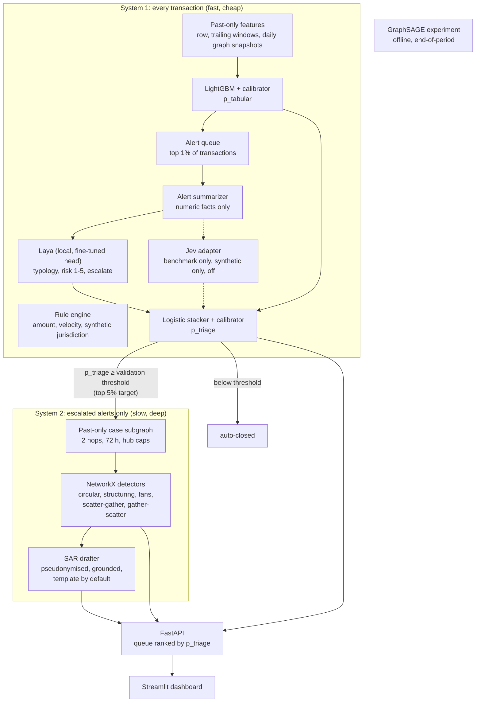
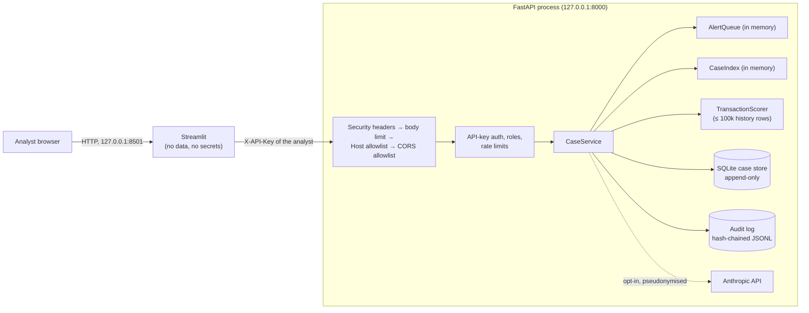

# Architecture

AML Sentinel is a two-stage triage pipeline over a transaction graph, with an
authenticated API and an analyst dashboard on top. This page describes what is built,
where each piece lives, and how data and trust flow between the pieces. The reasons
behind the design are in [DECISIONS.md](DECISIONS.md), and the threat model is in
[SECURITY.md](../SECURITY.md).

## The two systems

- **System 1** scores every transaction from past-only information. LightGBM forms
  the alert queue. Laya and the stacker refine the ranking inside the queue, because
  Laya costs about 300 ms per alert on the development GPU.
- **System 2** runs only on escalated alerts. It explains the alert (named accounts,
  payments and patterns) and drafts a SAR. On the measured data its evidence does not
  improve ranking (ADR-018), so the queue is ranked by System 1 `p_triage` (ADR-020).
- **The GNN** is an offline experiment. It sees whole periods, so it cannot score in
  real time (ADR-016).

## Module map (`src/aml_sentinel/`)

| Package / module | Responsibility |
|---|---|
| `config`, `exceptions`, `logging_utils`, `integrity`, `audit` | Settings from the environment (fail fast on missing secrets), the exception hierarchy, JSON logs with secret masking, SHA-256 verification, and the hash-chained audit log |
| `data/` | Loader and schema validation of the IBM file format, FX estimation (train only), time splits, laundering-pattern parsing, the synthetic sample generator, and checksum-verified parquet caches |
| `graph/` | Aggregated account graph (one edge per account pair per window) |
| `features/` | Past-only features: row, trailing windows (`temporal`), daily graph snapshots (`graph_features`) |
| `rules/` | Rule engine, static and tuned baselines, validation-based selection |
| `models/` | `Triage` protocol; LightGBM, rule, Laya and Jev adapters; calibrators (Platt, isotonic, smoothed isotonic); fusion stacker; System 1a/1b runners and reports; alert summarizer; typology mapping |
| `system2/` | Case builder, detectors, detector evaluation, GNN data/model/report |
| `ranking` | Final stacker (System 1 + System 2 evidence), informational only |
| `sar/` | Case facts, pseudonymisation, LLM client (Anthropic, opt-in), drafting, grounding, review checks for edited drafts |
| `evaluation/` | Confusion and ranking metrics, bootstrap tests, the Phase 8 studies and report |
| `api/` | FastAPI app, auth and rate limits, middleware, schemas, queue, scoring, case service, SQLite store |
| `dashboard/` | API client, pure view helpers, Streamlit app |
| `cli` | One entry point for every pipeline step (`aml-sentinel <command>`) |
| `demo` | `make demo`: rebuild the sample's models, mint per-run keys, run API + dashboard (ADR-024) |

## Data flow and artifacts

Every step reads the outputs of earlier steps from disk and writes its own. Data and
models are git-ignored; reports and figures are committed.

| Step (`aml-sentinel …`) | Reads | Writes | Integrity |
|---|---|---|---|
| `prepare-data` | `data/raw/*` or `data/sample/*` | `data/processed/<ds>.parquet` + manifest | Input and output SHA-256 in the manifest; verified on every load |
| `baseline` | processed parquet | `reports/baseline/<ds>.json` | n/a |
| `train-tabular` | parquet, baseline report | `models/<ds>/lightgbm_*.txt` (native format) + manifest, `calibrator_*.json`, `system1a_scores.parquet` | Model SHA-256 in its manifest; calibrator SHA-256 in the System 1a report; both verified before loading |
| `finetune-laya`, `triage-text` | System 1a scores, Laya checkpoint | `system1b_scores.parquet`, fusion JSON, report | Laya weights are safetensors, verified by our manifest and Laya's own `expected_sha256`, and loaded from a verified temporary copy (ADR-017) |
| `detect-patterns` | parquet, System 1b scores | `system2_evidence.parquet`, report | n/a |
| `gnn-experiment` | parquet | `gnn_sage.safetensors`, report | SHA-256 in the GNN report; verified by `load_trained_gnn` |
| `rank` | System 1b scores, evidence | `final_ranker.json`, `final_scores.parquet` | Model SHA-256 in the final report |
| `draft-sar` | final scores, parquet | `reports/sar/` (git-ignored: quotes dataset rows) | Every draft is audited |
| `evaluate` | all of the above | `reports/evaluation/<ds>.{json,md,png}` | n/a |
| `serve` | parquet, scores, evidence, models, evaluation report | `data/cases/cases.sqlite3`, `data/audit/audit.jsonl` | Append-only (SQLite triggers), hash-chained audit log |

No artifact is ever unpickled. Formats are native LightGBM text, JSON and safetensors.

## Time and leakage

Splits are half-open on time: train before 2022-09-07, validation 09-07 to 09-09,
test 09-09 to 09-11 (ADR-003).

- Features at time *t* use only rows before *t*. A test checks that deleting every
  later row leaves earlier features bit-identical.
- Trees are fitted on train. Calibrators, stackers and every threshold are fitted on
  validation. Test is used once, for reporting.
- `POST /score` rebuilds features from history at or before the transaction's
  timestamp. Tests show it reproduces the training score and is unaffected by later
  rows.
- System 2 cases end at the alert (strict horizon). The 24-hour horizon is a
  separate, labelled scenario.

## Runtime (API and dashboard)

- The API process loads the served dataset (`API_DATASET`) once at startup. That
  takes 0.4 s for the sample and 11 s for HI-Small.
- Request handlers are synchronous and run in FastAPI's thread pool. Writes to the
  audit log are serialised with a lock, because each record links to the previous one.
- The dashboard holds no data. It signs in with the analyst's own key, so the API's
  role checks and audit attribution apply to every click.
- `aml-sentinel demo` runs both: the dashboard as a child process
  (`python -m streamlit`, fixed argv) and the API in the foreground, stopping the
  dashboard when the API exits. In Docker, one container runs the same command
  with both servers on `0.0.0.0`, published only on the host's loopback.

## What production would add

Streaming ingestion with an online feature store (instead of rebuilding features
from history), a model registry with approvals, a shared rate limiter, OIDC identity,
TLS everywhere, WORM anchoring of the audit-log head, a four-eyes rule for filing,
monitoring for drift and calibration, and per-jurisdiction SAR formats. The README's
Limitations section lists the rest.
